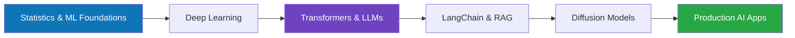

<!-- ======================= HEADER ======================= -->
<div align="center">


<a href="https://git.io/typing-svg">
  
</a>

<br/>


[](https://linkedin.com/in/omkar-jadhav-637807278/)
[](mailto:omkarjadhav3540@gmail.com)

</div>

---

## 🚀 About Me

```python
class OmkarJadhav:
    def __init__(self):
        self.role        = "Trainee @ Decimal Point Analytics (Strategic Initiatives & Prototyping)"
        self.education   = "M.Sc. Data Science, Fergusson College (Autonomous), Pune"
        self.background  = "B.Sc. Statistics, K.T.H.M. College, Nashik"
        self.location    = "Nashik, Maharashtra, India 🇮🇳"
        self.focus       = ["Generative AI", "LLM Applications", "Machine Learning", "Statistics"]
        self.learning    = ["Transformers", "LangChain", "Diffusion Models", "RAG Systems"]
        self.languages   = "4 spoken languages (incl. beginner Spanish)"

    def say_hi(self):
        print("Let's build something intelligent together!")
```

I'm a Data Science postgraduate with a strong statistical foundation, moving into **Generative AI** with a focus on LLMs, retrieval-augmented systems, diffusion models and AI-powered applications. I enjoy taking an idea from notebook to a clean, production-style app.

<table>
<tr>
<td>

- 🔭 **Currently working on:** building my own AI/ML projects
- 🌱 **Currently learning:** Transformers, LangChain, Diffusion Models
- 👯 **Looking to collaborate on:** open-source Generative AI projects
- 💬 **Ask me about:** Python, SQL, and statistics for AI
- ⚡ **Fun fact:** I speak 4 languages, including beginner Spanish!

</td>
</tr>
</table>

---

## 🛠️ Tech Stack

### 🧠 Generative AI & Deep Learning
<p>
  <br/>
  
  
  
  
</p>

### 📊 Data Science & Machine Learning
<p>
  <br/>
  
  
</p>

### 🌐 Backend, Frontend & Databases
<p>
  
</p>

### 🧰 Tools & Workflow
<p>
  
</p>

---

## 📈 GitHub Stats

<div align="center">


</div>

---

## 🗺️ Learning Roadmap



---

## 📫 Let's Connect

<div align="center">

I'm open to **internships, collaborations and open-source contributions** in AI/ML.

[](https://linkedin.com/in/omkar-jadhav-637807278/)
[](mailto:omkarjadhav3540@gmail.com)
[](https://github.com/omkarjadhav-projects-700)

<br/>

*"Data is the new oil, but AI is the engine."* ⚙️


</div>
